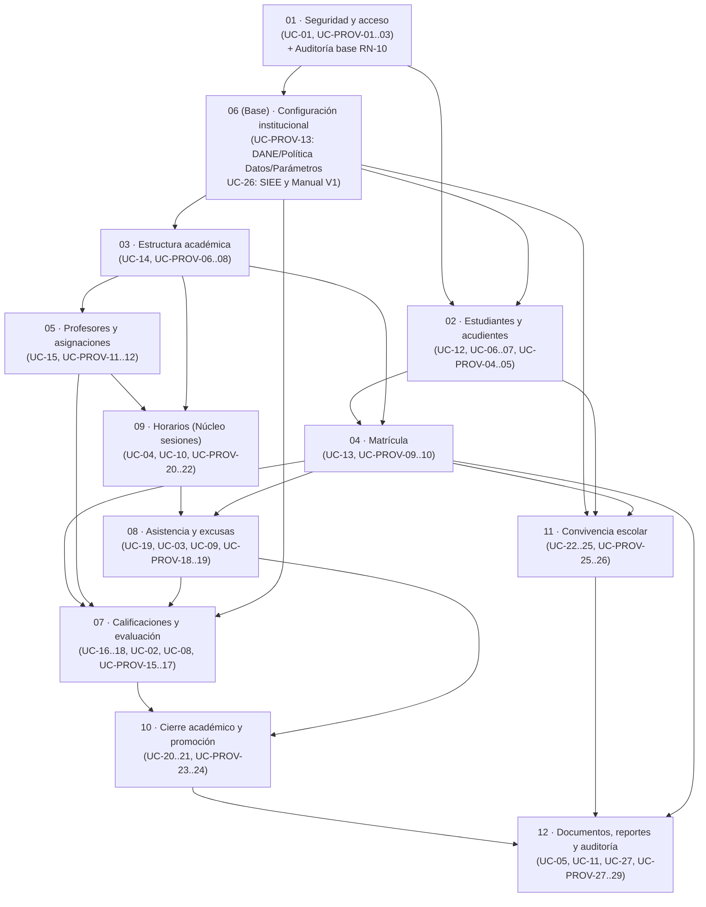

# Mapa de UC y dependencias (V2.0)

**Versión:** 2.0 — Consolidada tras auditoría y reescritura de los 12 módulos  
**Cobertura total:** 56 casos de uso (`UC-01` a `UC-27` originales + `UC-PROV-01` a `UC-PROV-29` provisionales aprobados)  
**Documentos de referencia:** `00_Guia_General_y_Reglas_Transversales_v2.docx`, `00_Indice_y_Secuencia_de_Desarrollo_v2.docx` y `Documento_Maestro_Sistema_Escolar_V2.md`

Cada caso de uso se asigna a un solo módulo. Los 27 identificadores `UC` originales se mantienen intactos y los 29 nuevos procesos aprobados conservan su identificador provisional `UC-PROV-*` hasta su ratificación en el catálogo definitivo.

---

## 1. Mapa consolidado de módulos, casos de uso y dependencias principales

| Módulo | Casos de uso incluidos | Total UCs | Dependencia funcional principal (Entrantes) |
| :--- | :--- | :---: | :--- |
| **01 — Seguridad y acceso** | `UC-01`, `UC-PROV-01`, `UC-PROV-02`, `UC-PROV-03` | 4 | Fundación técnica del backend (Spring Security, hashing BCrypt/Argon2, auditoría base `RN-10`); Política de Tratamiento de Datos y parámetros de sesión/login por nivel (`UC-PROV-13`); personas registradas y vínculos validados (`UC-12`, `UC-PROV-05`, `UC-PROV-11`). |
| **02 — Estudiantes y acudientes** | `UC-12`, `UC-06`, `UC-07`, `UC-PROV-04`, `UC-PROV-05` | 5 | Seguridad y acceso (`UC-01`, `UC-PROV-01`, `UC-PROV-02`); Política de Tratamiento de Datos vigente y parámetro institucional de mínimo de acudientes (`UC-PROV-13`, `RN-EST-05`); servicios de validación documental e identidad. |
| **03 — Estructura académica** | `UC-14`, `UC-PROV-06`, `UC-PROV-07`, `UC-PROV-08` | 4 | Seguridad y acceso (`UC-01`, `UC-PROV-02`); versión aprobada del SIEE para periodos, ponderaciones y régimen de Preescolar (`UC-26`); actas de aprobación del Consejo Académico y Consejo Directivo. |
| **04 — Matrícula** | `UC-13`, `UC-PROV-09`, `UC-PROV-10` | 3 | Expediente validado y vínculos sin restricción legal (`UC-12`, `UC-PROV-04`, `UC-PROV-05`); año lectivo y oferta de grupos con `cupoMaximo` (`UC-14`, `UC-PROV-06`); SIEE y Manual vigentes (`UC-26`); resultado de promoción previa en renovaciones y promoción anticipada (`UC-21`); protocolo de deserción (`UC-PROV-19 A2`) o resolución disciplinaria `EN_FIRME` (`UC-24 A3`, `UC-PROV-25`) en bajas. |
| **05 — Profesores y asignaciones docentes** | `UC-15`, `UC-PROV-11`, `UC-PROV-12` | 3 | Seguridad y acceso (`UC-01`, `UC-PROV-01`, `UC-PROV-02`); estructura académica, grupos y Plan de Estudios con `IHS` (`UC-14`, `UC-PROV-06`, `UC-PROV-07`); topes de carga horaria (`UC-PROV-13`); verificación vigente de inhabilidades Ley 1918 de 2018 (`UC-PROV-11`); validación de cruces si hay horarios publicados (`UC-PROV-20`). |
| **06 — Configuración institucional** | `UC-26`, `UC-PROV-13`, `UC-PROV-14` | 3 | Seguridad y acceso (`UC-01`, `UC-PROV-02`); gobierno escolar, actas numeradas de órganos colegiados (Consejo Académico, Comité Escolar de Convivencia, Consejo Directivo) y documentos legales oficiales del establecimiento (DANE, NIT, resoluciones y firmas). |
| **07 — Calificaciones y evaluación** | `UC-16`, `UC-17`, `UC-18`, `UC-02`, `UC-08`, `UC-PROV-15`, `UC-PROV-16`, `UC-PROV-17` | 8 | Seguridad y acceso (`UC-01`); vínculos verificados sin restricción legal y marcador PIAR (`UC-12`, `UC-06`, `UC-PROV-05`); matrícula y novedades (`UC-13`, `UC-PROV-09`, `UC-PROV-10`); periodos y Plan de Estudios con pesos de área y dimensiones de Preescolar (`UC-14`, `UC-PROV-06`, `UC-PROV-07`); asignación docente, suplencias y dirección de grupo (`UC-15`); SIEE aprobado/versionado (`UC-26`); excusas justificadas (`UC-19`, `UC-PROV-18`). |
| **08 — Asistencia** | `UC-19`, `UC-03`, `UC-09`, `UC-PROV-18`, `UC-PROV-19` | 5 | Seguridad y acceso (`UC-01`); vínculos verificados, autorizados de retiro físico y restricciones legales (`UC-12`, `UC-06`, `UC-PROV-05`); matrícula y fechas efectivas de traslado/retiro (`UC-13`, `UC-PROV-09`, `UC-PROV-10`); calendario de días lectivos hábiles (`UC-14 A4`); asignación docente y dirección de grupo (`UC-15`); umbrales y plazos del SIEE/Manual (`UC-26`); programación válida de sesiones y ubicación en tiempo real (`UC-PROV-20`, `UC-PROV-22 A1`). |
| **09 — Horarios** | `UC-04`, `UC-10`, `UC-PROV-20`, `UC-PROV-21`, `UC-PROV-22` | 5 | Seguridad y acceso (`UC-01`); vínculos verificados sin restricción legal (`UC-06`, `UC-PROV-05`); matrícula y cambios de grupo (`UC-13`, `UC-PROV-09`); calendario, grupos con capacidad y Plan de Estudios con `IHS` (`UC-14`, `UC-PROV-06`, `UC-PROV-07`); asignaciones docentes y suplencias (`UC-15`). |
| **10 — Cierre académico y promoción** | `UC-20`, `UC-21`, `UC-PROV-23`, `UC-PROV-24` | 4 | Membresías en órganos colegiados (`UC-PROV-02 A2`); documentos de identidad y consentimiento familiar (`UC-PROV-04`, `UC-PROV-05`); estructura, secuencia de grados y Plan de Estudios (`UC-14`, `UC-PROV-06`, `UC-PROV-07`); SIEE vigente y datos legales/firmas del colegio (`UC-26`, `UC-PROV-13`); calificaciones al 100 %, nivelaciones/habilitaciones, reclamos resueltos, convalidaciones y sábanas (`UC-16` a `UC-18`, `UC-PROV-15` a `UC-PROV-17`); asistencia y excusas resueltas (`UC-19`, `UC-PROV-18`, `UC-PROV-19`). |
| **11 — Convivencia escolar** | `UC-22`, `UC-23`, `UC-24`, `UC-25`, `UC-PROV-25`, `UC-PROV-26` | 6 | Seguridad y membresías del Comité de Convivencia/Consejo Directivo (`UC-01`, `UC-PROV-02 A2`); expediente, marcador PIAR, vínculos verificados y restricciones legales (`UC-12`, `UC-06`, `UC-PROV-05`); calendario de días hábiles (`UC-14`), matrícula (`UC-13`) y asignaciones (`UC-15`); Manual de Convivencia aprobado/versionado (`UC-26`); alertas de evasión interna (`UC-19 A2`). |
| **12 — Documentos, reportes y auditoría** | `UC-05`, `UC-11`, `UC-27`, `UC-PROV-27`, `UC-PROV-28`, `UC-PROV-29` | 6 | Seguridad y modo histórico (`UC-01 A3`, `UC-PROV-01 A3`); vínculos sin restricción legal y evolución documental (`UC-06`, `UC-PROV-04`, `UC-PROV-05`); versiones históricas de Plan de Estudios/SIEE y firmas legales (`UC-PROV-08 A2`, `UC-PROV-13`, `UC-PROV-14 A1`); matrícula/retiros, boletines, actas de promoción y graduación (`UC-13`, `UC-PROV-09`, `UC-20`, `UC-21`, `UC-PROV-24`); eventos de auditoría `append-only` generados transversalmente por los 12 módulos (`RN-10`). |

---

## 2. Dependencias clave por módulo

- **01 · Seguridad y acceso:** `UC-01` habilita la autenticación con rol activo único y el modo histórico restringido (`A3`); `UC-PROV-01` aprovisiona y administra cuentas; `UC-PROV-02` gestiona roles vigentes y membresías nominativas en órganos colegiados (`RN-SEG-01`); `UC-PROV-03` gestiona cambio y recuperación de contraseñas. La autorización contextual aplica en todos los módulos.
- **02 · Estudiantes y acudientes:** `UC-12` crea el expediente y vínculos base; `UC-PROV-04` gestiona actualizaciones, evolución documental (`RC -> TI -> CC`, `NES/PEP -> PPT/CE`) y reclamos Habeas Data; `UC-PROV-05` gobierna el único acudiente principal, las autorizaciones de retiro físico y el bloqueo inmediato por restricción legal (`BLOQUEADO_RESTRICCION_LEGAL`); `UC-06`/`UC-07` exponen consultas autorizadas.
- **03 · Estructura académica:** `UC-14` administra año lectivo, calendario y días no lectivos (`A4`); `UC-PROV-06` define niveles, secuencia de grados (`gradoSiguienteId`) y grupos con `cupoMaximo`; `UC-PROV-07` define áreas, asignaturas con `IHS` y ponderaciones al 100.00 %, y dimensiones cualitativas de Preescolar; `UC-PROV-08` expone consultas vigentes e históricas.
- **04 · Matrícula:** `UC-13` formaliza matrículas nuevas, renovaciones y traslados entrantes (`A5`); `UC-PROV-09` tramita cambios internos de grupo (`A1`), ascensos por Promoción Anticipada (`A2`), retiros/traslados salientes (`A3`), bajas por deserción/sanción en firme (`A4`) y anulaciones (`A5`); `UC-PROV-10` entrega historial y listados oficiales por grupo.
- **05 · Profesores y asignaciones docentes:** `UC-PROV-11` administra el expediente docente, verificación de inhabilidades Ley 1918 de 2018 y licencias/incapacidades; `UC-15` asigna carga académica por `IHS`, designa Directores de grupo (`A1`), asigna bloques unidocentes (`A2`) y ejecuta suplencias/relevos (`A3`) sin perder autoría histórica; `UC-PROV-12` expone consultas de planta y cobertura.
- **06 · Configuración institucional:** `UC-26` versiona e inmutabiliza el SIEE y el Manual de Convivencia con actas colegiadas; `UC-PROV-13` administra datos oficiales/firmas DANE, Política de Tratamiento de Datos y parámetros transversales; `UC-PROV-14` socializa versiones vigentes e históricas. **Debe inicializarse temprano** porque alimenta validaciones desde los Módulos 01 a 05 y es prerrequisito obligatorio de los Módulos 07 a 12.
- **07 · Calificaciones y evaluación:** `UC-16` configura actividades (incluyendo Preescolar y PIAR); `UC-17` registra/corrige calificaciones con cálculo jerárquico `BigDecimal` hasta Área Curricular y desempeño nacional; `UC-18` gestiona apoyos, nivelaciones con principio de no desmejoramiento y habilitaciones finales (`A4`); `UC-PROV-15` tramita reclamaciones de notas en 1.ª y 2.ª instancia; `UC-PROV-16` convalida notas de periodos previos por traslado o promoción anticipada; `UC-PROV-17` provee sábanas grupales y control de avance docente; `UC-02`/`UC-08` exponen lo publicable.
- **08 · Asistencia:** `UC-19` registra asistencia por sesión o jornada, detecta evasión interna (`A2`) y emite alertas sin reprobación automática (`RN-05`); `UC-PROV-18` gestiona radicación/resolución de excusas con reserva médica (`Ley 1581`), salidas anticipadas con verificación de retiro físico (`UC-PROV-05`) y propagación a evaluaciones supletorias (`UC-17 A1`, `UC-18 A2`); `UC-PROV-19` entrega consolidados grupales y documenta el protocolo de deserción (`UC-PROV-09 A4`); `UC-03`/`UC-09` presentan consultas individuales.
- **09 · Horarios:** `UC-PROV-20` configura aulas/franjas, estructura horarios verificando `IHS` y Triple No-Colisión (grupo, docente, aula) y publica versiones vigentes; `UC-PROV-21` gestiona cambios de aula, permutas, suplencias (`UC-15 A3`) y nuevas versiones sin alterar sesiones históricas de asistencia; `UC-PROV-22` provee el horario docente propio y la ubicación en tiempo real; `UC-04`/`UC-10` exponen horarios publicados a estudiantes y acudientes. **Su núcleo de sesiones (`UC-PROV-20`) debe coordinarse antes o en paralelo con `UC-19`.**
- **10 · Cierre académico y promoción:** `UC-PROV-23` gestiona observaciones de dirección de grupo y comisiones periódicas; `UC-20` valida pre-cierre, cierra/reabre periodos y emite boletines versionados (incluyendo boletín aplazado por incapacidad `A1`); `UC-21` formaliza actas de promoción anual, habilitaciones finales (`A1`), promoción automática en Preescolar (`A4`) y Promoción Anticipada (`A3`); `UC-PROV-24` verifica Servicio Social e ICFES Saber 11 para graduación de Media (11.°) y cierra el año lectivo (`CERRADO_HISTORICO` en `UC-14`).
- **11 · Convivencia escolar:** `UC-22` gestiona el Observador bilateral con adendas inmutables; `UC-23` activa la Ruta de Atención Integral Tipo I, II y III con reporte SIUCE y reserva ante agresor familiar (`A4`); `UC-PROV-25` instruye cargos, traslado de pruebas, descargos y recursos de reposición/apelación; `UC-24` formaliza medidas y sanciones verificando debido proceso y activando el Plan de Continuidad Académica (`A1`) hacia Módulos 07 y 08; `UC-PROV-26` registra actas del Comité Escolar de Convivencia, seguimiento externo y cierre; `UC-25` entrega vistas proyectadas con anonimización de terceros menores.
- **12 · Documentos, reportes y auditoría:** `UC-PROV-27` expide certificados anuales, certificados de notas parciales por retiro (`A1`), constancias y actas con código de verificación; `UC-PROV-28` administra carga, clasificación de confidencialidad, versionamiento y retención documental (TRD); `UC-05`/`UC-11` permiten consultar/descargar documentos (incluyendo modo histórico); `UC-27` genera reportes institucionales/SIMAT/SIUCE y consulta auditoría; `UC-PROV-29` verifica la integridad criptográfica SHA-256 de la cadena `append-only` de auditoría y gestiona su retención y exportación forense.

---

## 3. Interacciones críticas intermodulares (flujos cruzados)

| Flujo cruzado | Caso de uso origen | Caso de uso destino | Contrato funcional sincronizado |
| :--- | :---: | :---: | :--- |
| **Aprovisionamiento automático de cuentas** | `UC-13` / `UC-PROV-11` | `UC-PROV-01 (A1)` / `UC-PROV-02` | Al formalizar matrícula o alta docente se aprovisiona cuenta en `PENDIENTE_ACTIVACION` sin duplicar personas. |
| **Bloqueo por restricción legal parental** | `UC-PROV-05 (A3)` / `UC-23 (A4)` | `UC-01` / `UC-06`–`UC-11` / `UC-25` / `UC-PROV-18` | Revocación inmediata de sesiones, bloqueo `HTTP 403` de consultas y prohibición de retiro físico en portería. |
| **Traslado entrante y Promoción Anticipada** | `UC-13 (A5)` / `UC-21 (A3)` / `UC-PROV-09 (A2)` | `UC-PROV-16` | Convalidación u homologación formal de notas de periodos previos cerrados hacia el Plan de Estudios y SIEE local. |
| **Relevo o suplencia docente** | `UC-PROV-11 (A2)` $\rightarrow$ `UC-15 (A3)` | `UC-16` / `UC-17` / `UC-19` / `UC-PROV-21 (A2)` | Transferencia operativa de actividades, planillas, asistencia y horario al suplente conservando autoría histórica del titular. |
| **Excusa aprobada $\rightarrow$ Evaluación diferida** | `UC-PROV-18` | `UC-17 (A1)` / `UC-18 (A2)` / `UC-20 (A1)` | Propagación multisesión de `AUSENCIA_JUSTIFICADA` y habilitación de `PENDIENTE_POR_EXCUSA_JUSTIFICADA` / boletín aplazado. |
| **Horario publicado $\rightarrow$ Sesiones de asistencia** | `UC-PROV-20` / `UC-PROV-21` + `UC-14 (A4)` | `UC-19` / `UC-PROV-18 (A1)` | Definición de sesiones programadas válidas sin días no lectivos y ubicación en tiempo real del menor en portería (`UC-PROV-22 A1`). |
| **Plan de Continuidad Académica en sanciones** | `UC-24 (A1)` | `UC-16` / `UC-17` / `UC-19` / `UC-PROV-18` | Garantía constitucional (`RN-08`) de actividades evaluables y ausencia de fallas injustificadas durante suspensión presencial. |
| **Firmeza sancionatoria / Protocolo deserción $\rightarrow$ Baja** | `UC-24 (A3)` + `UC-PROV-25` / `UC-PROV-19 (A2)` | `UC-PROV-09 (A4)` | Precondición obligatoria para ejecutar retiros por deserción o cancelaciones de matrícula sin violar el debido proceso. |
| **Retiro / Graduación $\rightarrow$ Modo histórico y Certificación** | `UC-PROV-09 (A3)` / `UC-PROV-24` | `UC-PROV-01 (A3)` / `UC-PROV-04 (A4)` / `UC-PROV-27` | Transición de cuentas a `INACTIVA_HISTORICA`, cierre del año lectivo (`UC-14`) y expedición de certificados parciales o actas de grado. |
| **Auditoría transversal `append-only`** | Módulos `01` a `12` (`RN-10`) | `UC-27` / `UC-PROV-29` | Registro atómico desde la Fase 1 con `valorAnterior`, `valorNuevo`, `correlationId` y cadena SHA-256 sin secretos. |

---

## 4. Secuencia recomendada de implementación técnica

Aunque los documentos conservan su numeración lógica `01` a `12`, el grafo de dependencias reales establece el siguiente orden pragmático de construcción en Spring Boot + PostgreSQL/Flyway + OpenAPI + Angular:

